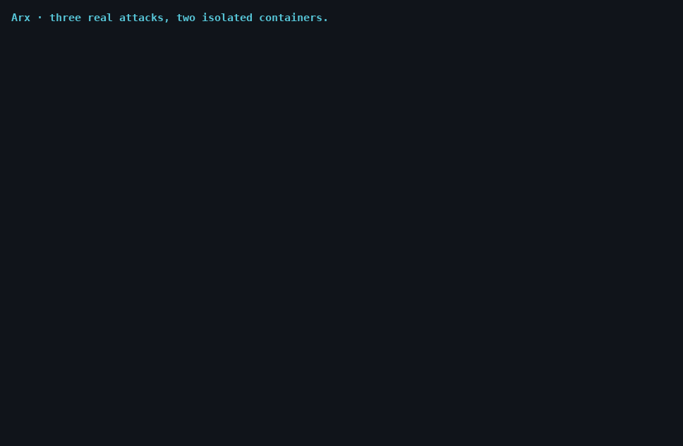

<h1>Arx</h1>

**Autonomous defensive security for Linux servers.** Arx learns what *normal* looks like
on your machine, notices what doesn't belong, and contains it on its own, using only
actions it can undo. Anything irreversible waits for you.



<sub>Real output of [`lab/demo.sh`](lab/demo.sh), with long waits shortened.</sub>

> **Status:** v0.0.8rc3 (Core release candidate), early public testing. **Arx Core is free and available now.** The paid
> tiers open after Core completes its public testing phase, **Pro first, Business last**.
> Founding pricing (half price, first 500 purchases of each plan) is reserved for that
> opening: [get notified](https://github.com/mperez90/Arx/discussions/1).
> © ASL — Advanced Systems Laboratories.

---

## Why

Classic tooling raises an alert and waits for a human, and the breach happens in the gap
between detection and response. Arx closes that gap on a single server with no SOC behind
it: it answers first, with reversible actions, and leaves the hard decisions to you.

## Try it without risk

Arx starts in **observe mode**. Without `--enforce` it blocks nothing and never touches a
process; it only reports what it would have done.

```bash
curl -fsSLO https://raw.githubusercontent.com/mperez90/Arx/f1-core-mvp/packaging/install.sh
less install.sh          # a root installer for a security tool: read it first
sudo sh install.sh       # Debian/Ubuntu; verifies the package's SHA-256

sudo arx setup           # authorization word; LLM keys and alerts are optional
sudo arx recon           # map this server
sudo arx learn           # learn what's normal; repeat over a few days
sudo arx learn --seal    # close the baseline
sudo arx guard           # watch, in observe mode (Ctrl-C to stop)
```

When you trust what it reports, switch on the automatic responses with
`sudo arx guard --enforce`, or run it 24/7 under systemd with
`sudo arx service install --enforce`. On other distros, download `arx.pyz` from
[Releases](https://github.com/mperez90/Arx/releases) and run it with Python 3.10 or newer.
From v0.0.7 each release also carries signed build provenance:
`gh attestation verify arx.pyz -R mperez90/Arx`.

**What observe mode does change on your system:** its config and state (`/etc/arx`,
`/var/lib/arx`), a backup of your critical files in its vault when you seal the baseline,
its own `inet arx` nftables table (a passive SYN tracker and empty block sets), and auditd
watch rules if auditd is installed.

## What it does against real attacks

Don't take the table's word for it. `bash lab/docker-lab.sh` runs these attacks with real
tools in two isolated, throwaway containers, and `bash lab/demo.sh` is the short version
shown above. Both only need Docker.

| Attack | Arx's response | Verified by |
|---|---|---|
| Port scan (`nmap -sS`) | Blocks the source IP | Lab |
| SSH brute force | Blocks the source IP | Lab |
| New service from a signed package (`apt install nginx`) | Alerts only: it proves it comes from a signed repository, intact, started by its own unit | VM |
| New listening port from software that can't prove that (a stray `.deb`, a unit no package owns) | Blocks the port | VM |
| New program of unproven origin, with no sign of harm | Confines it: it keeps running, but can't open connections. Survives restarts and reboots | VM |
| Dropper in `/tmp`, a hidden path, or started by a web server | Suspends the process | Lab, VM |
| A signed update whose install script plants an SSH key | Confines the service: it keeps serving, without network. The key raises its own critical alert | VM |
| A signed update of a library a service loads, like the xz backdoor (the service itself didn't change) | Confines the services that load it; they keep serving | VM |
| A trusted service starts doing something it never did, like a tampered update calling home | Cuts that action in the kernel and tells you; the service keeps running | VM |
| A watched service starts a program it never started | That process loses its network in a scope of its own; the service keeps running. A new tool from a verified package that isn't a shell, interpreter or downloader only raises an alert | VM |
| sshd runs anything before authenticating (the xz backdoor's pattern), also with OpenSSH 10 and per-connection sshd | Freezes it and whatever it already started within milliseconds, in a frozen cgroup an outside SIGCONT can't wake; critical alert | VM |
| A watched service looks up a domain it never used | Alert, higher if the name looks machine-generated; the connection itself is cut by its behavior profile | VM |
| A library injected into a service (`/dev/shm`, a hidden path, no package, a new `LD_PRELOAD`) | Critical alert; the service keeps running without outbound network | VM |
| A service opens shadow, private keys or cloud credentials it never opened | The service keeps running without outbound network; alert | VM |
| A web server or database starts a shell or a downloader as its service user (webshell) | Freezes that process; the server keeps running | VM |
| An untrusted OpenSSH update | sshd loses outbound network except DNS and its authentication servers; open sessions and new logins keep working | VM |
| Someone stops Arx or edits its unit or files | Alert through your channels | VM |
| Reverse shell from `bash`, `sh`, `nc` or `socat` | Cuts the channel and suspends only that process | Lab |
| New SUID binary | Critical alert naming it; on your word, drops the bit | Lab |
| Persistence planted in cron | On your word: restores from the vault and quarantines the planted file | Lab |
| Decoy (canary) file read | High-severity alert | Lab |
| Unknown or new-origin login, with or without a terminal | On your word, or the model's (see below): closes password and SSH-key access, its open sessions and whatever they started, and blocks its source IP. Only you lift it | Lab |
| A second root account (uid 0) | Critical alert; on your word, locks it without touching root | Lab |
| Authentication log truncated | High-severity alert | Unit tests |

Real systemd, real `ufw` and a simulated day of normal admin work have their own labs. What needs
a real kernel (cgroups, a reboot) runs on two VMs, the second one as the attacker:
`bash lab/lima-lab.sh`. The full test plan and its results are in [`lab/README.md`](lab/README.md).

## Everything from the console

There is no web UI, on purpose. An agent that defends a server shouldn't add another login page to
it. These are the ones you'll use most; `arx --help` lists them all:

| Command | What it's for |
|---|---|
| `arx status` | How things stand. `--json` for scripts |
| `arx authorize` | What's waiting for your decision |
| `arx unlock` | Accounts Arx has locked. They stay locked until you say so |
| `arx accept` | "This is normal": it stops flagging it and lifts its block right away |
| `arx restore` | Files in quarantine, back to where they were |
| `arx proposals` | What Arx suggests changing, like closing SSH passwords. Nothing applies by itself |
| `arx metrics` | How much noise it makes on this host. `--json` has only numbers, safe to share |
| `arx scan <file>` | Static verdict on a file, without ever running it |
| `arx forensics` | A sealed report of what happened |
| `arx vaccines` | Signed updates with what other Arx hosts learned (the channel isn't open yet) |

If you want to hear from it, or decide from your phone, give it your own Telegram bot in `arx setup`.
Acting from the chat takes a one-time code from an authenticator app: your authorization word never
travels through a chat. It only makes outbound connections and opens no port.

Output is in English; Arx also speaks Spanish. Pick it in `arx setup` or with `ARX_LANG=es`.

## The doctrine: relentless, but reversible

| Tier | What happens | Authority |
|------|---------|-----------|
| **0** | Record evidence and alert | Automatic, always |
| **1** | Block an IP, a port or a reverse-shell channel; suspend a suspicious process; confine a program of unproven origin | Automatic with `--enforce`; each action undoes itself after 60 minutes, except confinement, which waits for you |
| **2** | Restore critical files, quarantine what was planted, lock an account and close its sessions, end a process that came back | **You**, with your authorization word |

**One exception, on purpose.** With a model configured and `--enforce`, if the model confirms as a
threat, or as a serious suspicion (70% or more), a login the rules already flagged, Arx closes that
account's access without waiting and tells you with the full context. A closed session can't be
reopened, so this is the one irreversible thing that doesn't wait for you. The model can't choose
who: its verdict only counts on a login already flagged in the same batch, and code validates the
rest. It never applies to root, system accounts or the last account that can administer the host,
without a live session Arx can verify, or more than twice an hour. Turn it off in `arx setup`.

Guardrails against self-inflicted damage:

- It never acts on your SSH port, PID 1, itself, the host's own IPs or an authenticated SSH
  session it has seen persist across checks. A connection that never logged in protects nobody.
- New software is judged by proof, not by its path. If it comes from a package in a signed
  repository, intact, it's only logged. If it can't prove that, it's confined: it keeps working,
  without network. Only signs of harm suspend it: a temporary or hidden path, a static-analysis hit,
  being started by a web server, or coming from an unknown login. All of this needs `--enforce`.
- After 5 automatic actions in an hour it stops acting and only observes. Critical findings keep a
  small reserve, so exhausting the brake on purpose doesn't leave a reverse shell unanswered.
- An account can't be locked if it would leave nobody able to administer the server.
- If a threat comes back after its block expires, Arx doesn't re-block in a loop. It asks you.

Losing contact with our servers doesn't disarm Arx. Licensing fails open, degrading at
worst to the free tier.

## Known limits

Read these before you rely on it.

- **It sweeps, it isn't instantaneous.** Checks run every 30 seconds by default, so a fast
  attacker has that long. Scan tracking runs in the kernel; most other checks do not.
- **Reverse shells written in Python, Perl or PHP aren't caught yet.** Those interpreters
  are common in legitimate servers, so this detection is limited to shells and `nc`/`socat`.
  A legitimate long-lived `nc` client would be flagged; mark its IP out of bounds in setup.
- **Containment expires by design, except accounts and confinement.** After 60 minutes a suspended
  process resumes and its channel reopens. If the threat is still there, it is escalated to you, not
  re-blocked. A locked account stays locked until you run `arx unlock`, and a confined program stays
  without network until you run `arx accept`.
- **An attacker can exhaust the safety brake for non-critical findings.** Five actions in an hour
  trips it on purpose or by accident, and from then on Arx only alerts on those.
- **Software that can't prove its origin is contained under `--enforce`.** A package from a signed
  repository only raises an alert. Your own app in `/opt` keeps running, but without network, and a
  port it exposes is blocked, until you run `arx accept`. That's deliberate: a planted program looks
  exactly the same.
- **The proof of origin starts from dpkg.** It only exists on Debian and Ubuntu; elsewhere nothing
  counts as proven, so everything new is contained. A signature alone isn't enough: after an update,
  Arx also checks the package against a fresh copy from its repository, known-malicious databases
  and its install scripts, and watches what the service does and what it starts. sshd running anything
  before authenticating (the xz backdoor's pattern) is frozen on the spot. Still hard: a backdoor that
  neither starts a program nor talks somewhere new. An intruder who is already root can stop Arx; you
  get told.
- **Confining needs cgroup v2, nftables that can match by cgroup, and systemd.** Without them, Arx
  suspends instead. Tested on Ubuntu 22.04 and 24.04 VMs, across service restarts and reboots.
- **Run Arx on the host, not inside a container that shares the host's cgroup tree.** There, proof
  of origin and confinement work, but behavior watching doesn't. LXC containers (tested unprivileged,
  with Incus) work like a machine.
- **Blocks work best with `nftables`.** The package recommends it. With only `ufw`, a block doesn't
  cut connections already open and won't touch a port you already have a rule for. With neither,
  it reports that it can't block. Cutting a reverse-shell channel always needs `nftables`.
- **The model reads data an attacker can write.** At worst, a successful prompt injection could get
  a flagged login locked. It can't pick another account, reach root or lock you out of the host,
  and `arx unlock` undoes the lock, but not the closed sessions.
- **Without journald, `auth.log` can be forged.** Any local user can write to it with `logger`, and
  that could get an IP blocked for an hour. Hosts with journald, which is nearly all of them, read
  from it instead, where that doesn't work.
- **Root can stop Arx.** An attacker who is already root can disable the service, and nothing warns
  you when that happens. A silent Arx isn't proof of a quiet server.
- **Ransomware is only seen through its decoys.** Plant them with `arx canaries plant`. Arx doesn't
  recognize mass encryption itself, and doesn't prevent it.
- **Locking an account ends everything running under it,** services included, and lists it for you.
  It doesn't cover what doesn't go through that account: API tokens, keys stolen for other services,
  or persistence already installed as root.
- **`arx scan` is heuristic.** It uses a small rule set, and "clean" only means no rule
  matched. On large files it reads the start and the end, and says so.
- **The forensic seal has a limit.** It detects later edits to a report, but not edits made
  to the log before the report was generated, and root on the same host can re-sign one.
- **False-positive rates on real servers haven't been measured.** That's what this testing
  phase is for, and why observe mode comes first.
- **Linux only.** The package targets Debian and Ubuntu.

## How it's built

Two layers, on purpose. A **fast, deterministic** layer of sensors and rules contains
threats, with no network and no model involved. An optional **slow** layer, a model using
**your own API keys**, reads new findings and explains them. It's off the hot path, receives
telemetry marked as untrusted with secrets redacted, and has one narrow, validated say: the
exception above. Everything in the table works without any API key: without a model, those
decisions wait for you.

Python standard library only, no pip dependencies. It uses osquery, auditd and Falco if you
already have them, and falls back to `/proc` if you don't. The lifecycle is four words:

```
setup  →  recon  →  learn  →  guard
```

## When it alerts

[docs/runbook.md](docs/runbook.md): what each alert means, what Arx already did and what you decide.

## Removing it

```bash
sudo arx canaries list       # note any decoys you planted, then delete them
sudo arx unlock              # unlock any account you left locked
sudo arx proposals           # undo any applied change: arx proposals revert <id>
sudo apt purge arx           # also deletes /etc/arx and /var/lib/arx (its evidence and vault)
```

Removing the package gives the network back to everything Arx confined and takes its units, drop-ins
and nftables table with it (`apt remove` keeps the configuration and state).

Its auditd watch rules, if any, disappear on reboot.

## Editions

| Edition | For | Availability |
|---------|-----|--------------|
| **Core** | The full defense above, on your own servers | **Free, available now** |
| **Pro** | Managed threat intelligence, advanced detections, curated self-testing of your own host | Planned, after Core's testing phase |
| **Business** | Fleet console, hosts that defend each other, compliance reports, authorized assessment of your own fleet | Planned, after Pro |

**Core is defensive only. Paid tiers add authorized assessment of your own assets, with
scope enforced in code and human approval per exercise.** Arx never attacks third parties.
That rules out hack-back, including against whoever is attacking you.

## License

Core is **source-available, not open source**: it's licensed under the Business Source
License 1.1, and you may use, modify and self-host it to defend systems you own or operate,
including inside a business, free of charge. Each version becomes Apache 2.0 four years
after its release. See [`LICENSE`](LICENSE) and [`NOTICE`](NOTICE).

Core stays free. If it defended your machine, you can fuel the roadmap with the **Sponsor**
button (pay what you want, one-time or monthly).

---

*Arx — the citadel keeps itself.*
